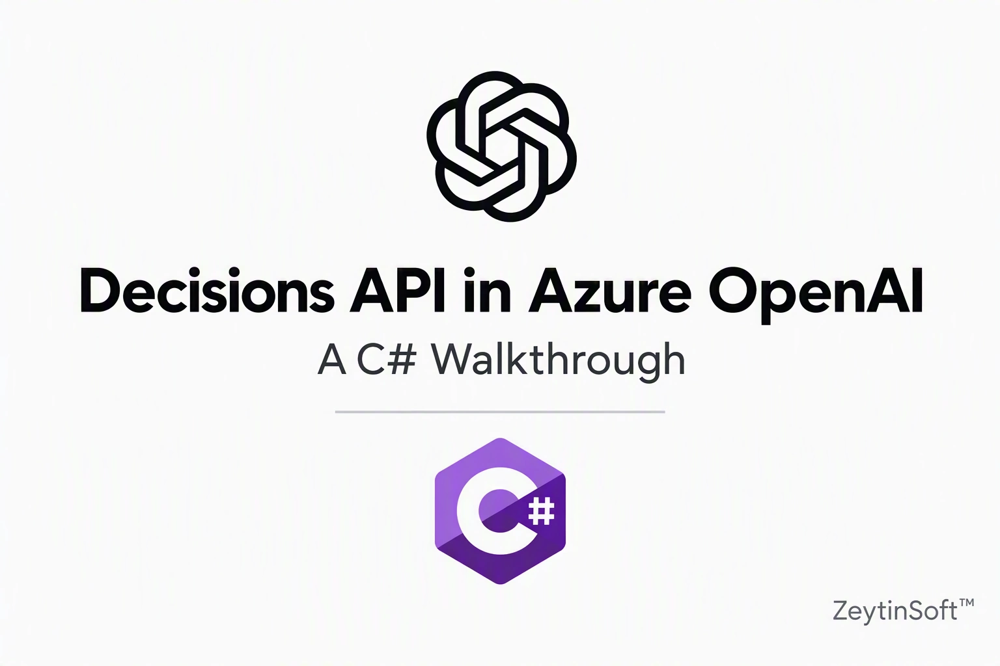

# Azure OpenAI Decisions API for C# and .NET 10 on Microsoft Foundry



[](https://github.com/taswar/OpenAI-DecisionApi-CSharp-Sample/actions/workflows/dotnet.yml)


- 📖 Full walkthrough: [Decisions API in Azure OpenAI: A C# Walkthrough](https://taswar.zeytinsoft.com/decisions-api-in-azure-openai-a-c-walkthrough/)
- ⭐ If this saved you time, star the repo so other .NET developers can find it.
- For more C# Samples using other AI Models check out [AI models for C# developers](https://taswar.zeytinsoft.com/foundry-ai-models-csharp/)
- For my Free Ebook on Prompt Engineering check out [Prompt Engineering for .NET Developers](https://github.com/taswar/PromptEngineeringForDotNetDevelopers)


A small .NET 10 console app that sends a support ticket to the **Azure OpenAI Decisions API**. It prints:

- the probability that the customer is asking for a refund (`refund_requested`, a predicate)
- the department that should handle the ticket (`billing`, `technical`, `shipping`, or `other`) and its confidence
- a severity score across three levels (Cosmetic, Workaround available, Fully blocked) and its confidence

If the model refuses to answer a question, the app says to send the ticket to a person instead of treating the refusal as a low probability.

## Quick start

```bash
git clone https://github.com/taswar/OpenAI-DecisionApi-CSharp-Sample.git
cd OpenAI-DecisionApi-CSharp-Sample
dotnet user-secrets set "AZURE_OPENAI_ENDPOINT" "https://<resource>.openai.azure.com"
dotnet run
```

Without an API key, the app signs in with Entra ID, so run `az login` first. See [Configuration](#configuration) for all settings.

## Prerequisites

- [.NET 10 SDK](https://dotnet.microsoft.com/download)
- An Azure OpenAI resource with a `gpt-6-luna` deployment. GPT-6 Luna is currently the only model the Decisions API supports, and the API is generally available in Microsoft Foundry.
- Either an API key for the resource, or Azure credentials that `DefaultAzureCredential` can use (for example, `az login`) and permission to call the resource

## Configuration

The app reads these settings from user secrets or environment variables:

| Name | Required | Description |
| --- | --- | --- |
| `AZURE_OPENAI_ENDPOINT` | Yes | Base URL of the Azure OpenAI resource, with no path, for example `https://<resource>.openai.azure.com` |
| `AZURE_OPENAI_DEPLOYMENT` | No | Deployment name. Defaults to `gpt-6-luna` |
| `AZURE_OPENAI_API_KEY` | No | API key. If not set, the app uses `DefaultAzureCredential` |

Set them with user secrets from the project folder:

```bash
dotnet user-secrets set "AZURE_OPENAI_ENDPOINT" "https://<resource>.openai.azure.com"
dotnet user-secrets set "AZURE_OPENAI_DEPLOYMENT" "<your-deployment-name>"
# Optional: leave this out to use DefaultAzureCredential instead
dotnet user-secrets set "AZURE_OPENAI_API_KEY" "<your-api-key>"
```

## Run

```bash
dotnet run
```

Example output:

```
refund_requested: 100% true
department: billing (confidence 100%)
severity: 0.98 (confidence 13%)
```

## How it works

`Program.cs` POSTs to `{AZURE_OPENAI_ENDPOINT}/openai/v1/decisions`. If `AZURE_OPENAI_API_KEY` is set, the request uses an `api-key` header. If it isn't, the app gets a token for `https://cognitiveservices.azure.com/.default` and sends it as a bearer token. The body contains the deployment name (`model`), the ticket text (`input`), and three questions: `refund_requested` (predicate), `department` (choice), and `severity` (score). `PrintAnswer` reads each item in the response's `answers` array and handles it according to its `type`, which includes `refusal`.

## Troubleshooting

### `Decisions API returned 404`

The endpoint URL is wrong. The app appends `/openai/v1/decisions` to `AZURE_OPENAI_ENDPOINT`, so the value must be the base URL only.

- **Wrong:** `https://<resource>.openai.azure.com/openai` (any path such as `/openai`, `/openai/v1`, or `/openai/deployments/...` is appended to the route and produces a bad URL)
- **Right:** `https://<resource>.openai.azure.com`

A trailing slash is fine because the app trims it. If the base URL is correct and you still get 404, check that `AZURE_OPENAI_DEPLOYMENT` matches the name of your deployment exactly.

### Your endpoint change has no effect

Environment variables override user secrets. If `AZURE_OPENAI_ENDPOINT` is set in your shell, update or unset it there (`echo $AZURE_OPENAI_ENDPOINT` shows the current value), or the old value is still used.

To check which value the app sees, list the secrets:

```bash
dotnet user-secrets list
```

### `400: no_content_length_header`

The request was sent without a `Content-Length` header. This is fixed in the current `Program.cs`, which sends the body with `StringContent`. If you see this error, make sure your copy includes that change and does not use `JsonContent`.

### `401` or `403` responses, or credential errors

- If you use an API key, check that `AZURE_OPENAI_API_KEY` belongs to the same resource as the endpoint.
- If you use keyless auth, run `az login` and check that the signed-in account has the **Cognitive Services OpenAI User** role on the resource.
- `DefaultAzureCredential` uses the first credential that works, so a different cached login can be used. Sign out and sign in again with the right account if needed.

### `KeyNotFoundException` when reading the response

The response shape differs from what the parser expects. Print the raw response (or check the `Unexpected answer:` lines in the output) and compare it with `PrintAnswer` in `Program.cs`.

## Related projects

Looking for a different decision model, or a reranker for RAG? See the companion samples:

- **[Microsoft-Decision-1 C# Demo](https://github.com/taswar/Microsoft-Decision-1-Csharp-Demo)** is a .NET 10 console app that uses **Microsoft-Decision-1**, the decision model in Microsoft Foundry, for fast decision scoring. It routes a support ticket to a team, scores its severity, and checks for repeat contact, using `DefaultAzureCredential`.
- **[Cohere Rerank v5 Pro & Fast C# Sample](https://github.com/taswar/Cohere-Rerank-V5-Pro-Fast-Csharp-Sample)** is a .NET 10 console app that reranks search results for RAG with **Cohere Rerank v5 Pro and Fast** on Microsoft Foundry, and uses a calibrated score to decide which passages reach the chat model.

Comparing this sample with the Decision-1 demo shows the same support-ticket triage done with the Azure OpenAI Decisions API (predicate, choice, and score questions) and with Microsoft-Decision-1 (choice, score, and noul questions) in C#.

## License

This project is licensed under the MIT License. See [LICENSE](LICENSE).
